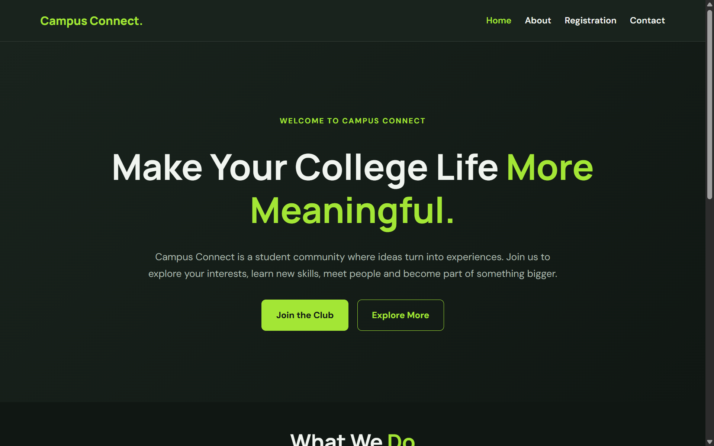
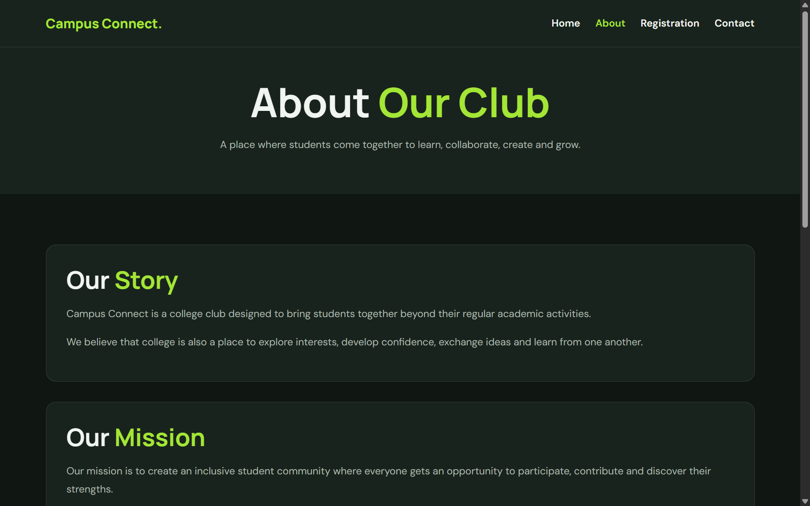
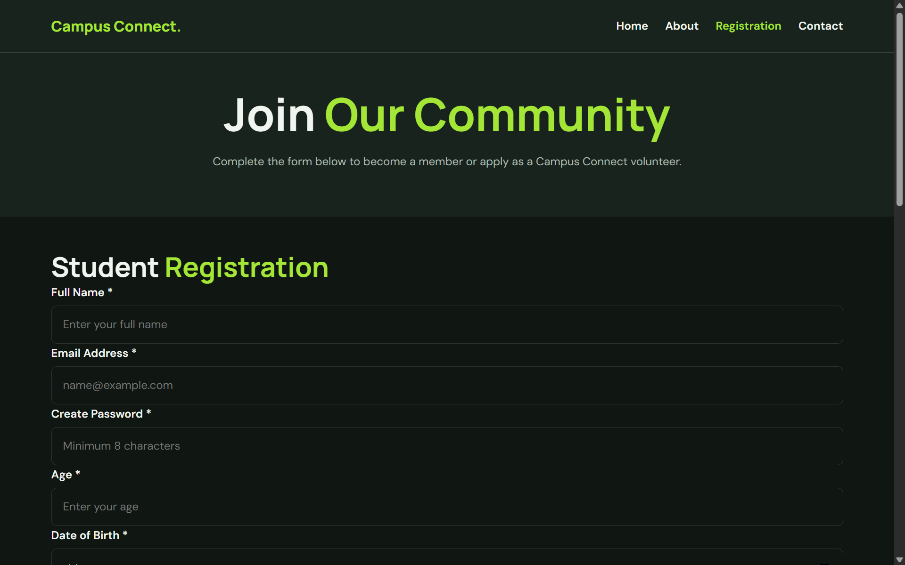
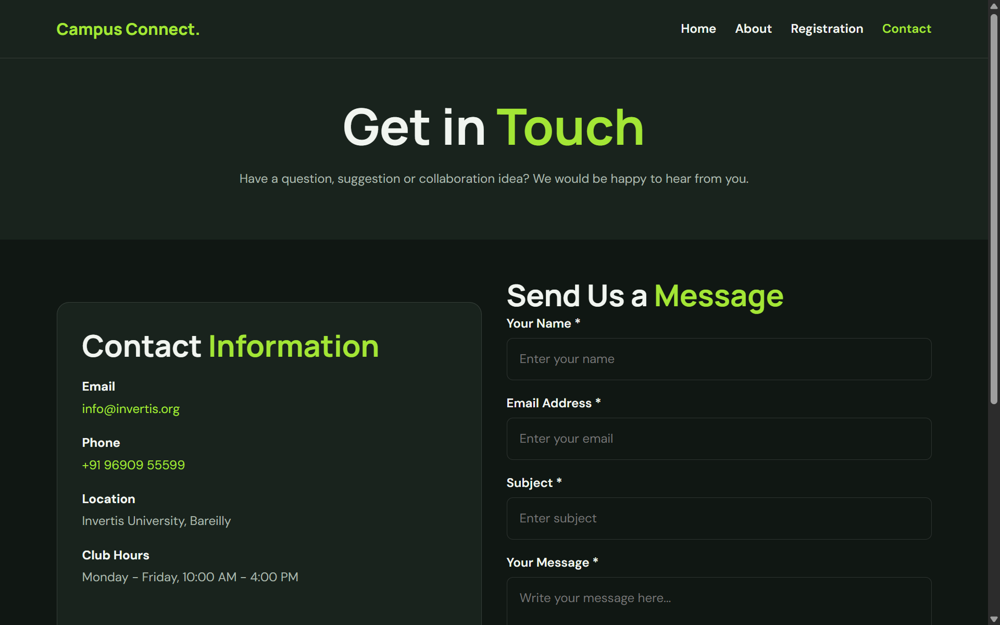
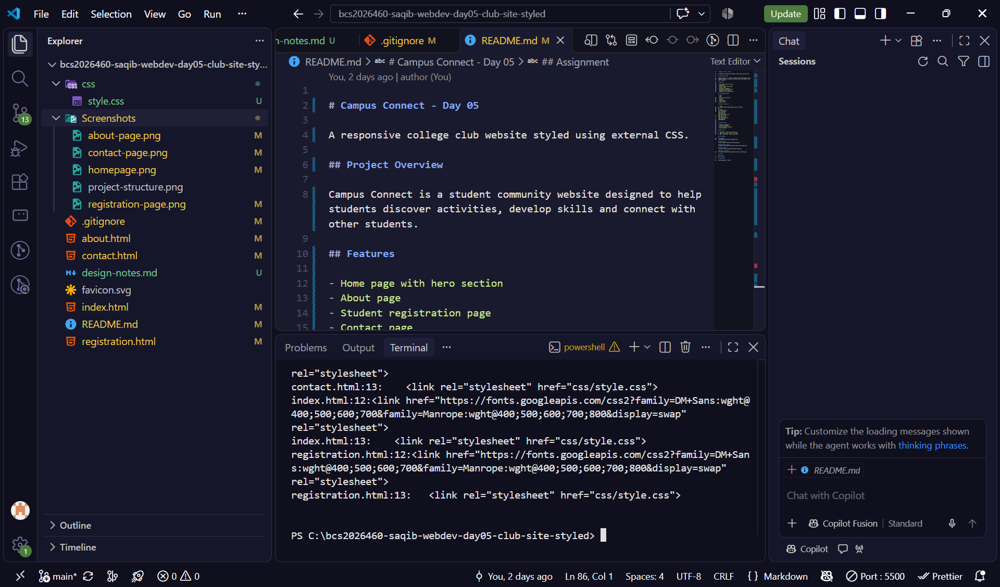

# Campus Connect - Day 05

A responsive college club website styled using external CSS.

## Project Overview

Campus Connect is a student community website designed to help students discover activities, develop skills and connect with other students.

## Features

- Home page with hero section
- About page
- Student registration page
- Contact page
- Responsive navigation
- Reusable CSS design tokens
- Responsive card layouts
- Consistent dark green theme

## Technologies Used

- HTML5
- CSS3
- CSS custom properties
- Flexbox
- CSS Grid
- Media Queries
- Google Fonts

## Project Structure

```text
bcs2026460-saqib-webdev-day05-club-site-styled/
│
├── css/
│   └── style.css
├── Screenshots/
├── index.html
├── about.html
├── registration.html
├── contact.html
├── favicon.svg
├── design-notes.md
├── .gitignore
└── README.md
```

## Design Theme

- Background: #101713
- Surface: #19231d
- Primary Accent: #a3e635
- Text: #f1f5f0

## How to Run

1. Download or clone this repository.
2. Open the project folder in VS Code.
3. Open `index.html` using Live Server.

## Screenshots

### Homepage


### About Page


### Registration Page


### Contact Page


### Project Structure


## Author

Saqib Ansari

## Assignment

Web Development - Day 05
